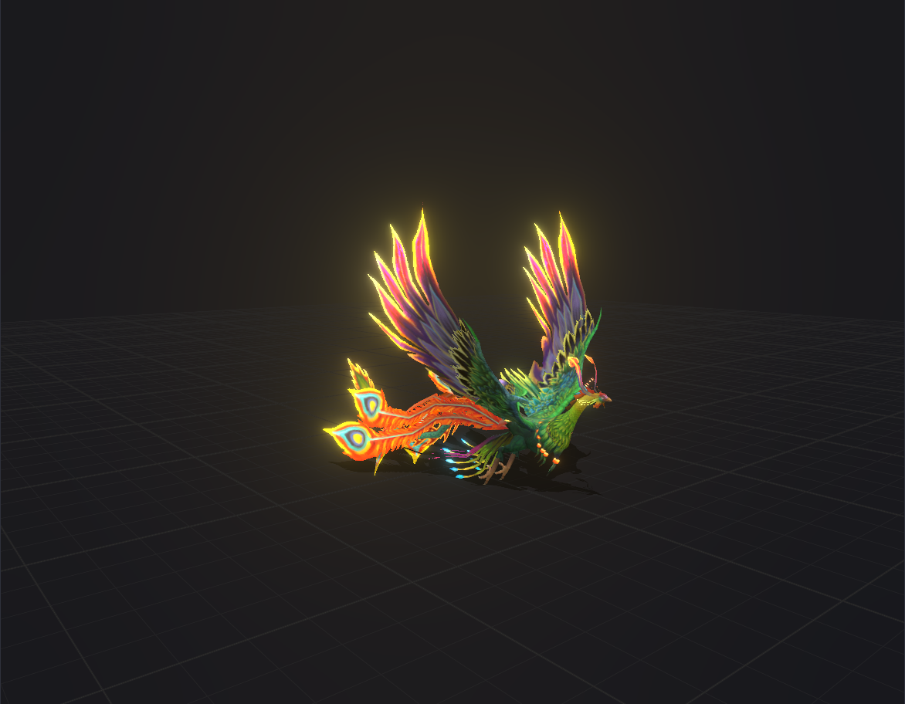

# Phoenix Flight

A 3D scene of an animated phoenix flying in a circle over a glowing grid, built with React Three Fiber.

**Live demo:** https://your-app.vercel.app

## Features

- Animated glTF model: wing flap clip played with drei's `useAnimations`
- Circular flight path with a gentle bob, and the bird turns to face its direction of travel
- Soft real-time shadows on a grid floor
- Bloom post-processing, so only the bird's emissive feathers glow
- Orbit controls limited to stay above the floor and outside the flight path

## Tech

React, Vite, Three.js, @react-three/fiber, @react-three/drei, @react-three/postprocessing

## Run locally

    npm install
    npm run dev

## What I learned

- How an animated model is built: skeleton, skinned meshes and clips
- Why clips flap in place, and why travel is done by moving a parent group
- Auto-sizing and centring a model from its bounding box
- Fixing see-through feathers with `alphaTest` and `DoubleSide`
- Culling and shadow-camera setup for skinned meshes
- Making bloom affect only chosen parts, using the threshold and emissive strength

## Credits

"MODEL TITLE" by AUTHOR NAME, licensed under [CC BY 4.0](https://creativecommons.org/licenses/by/4.0/), via [SOURCE](SOURCE_URL). Modified: scaled and re-centred, materials and glow adjusted.
